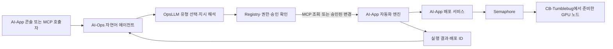

<h1 align="center">AI-Ops</h1>

<p align="center">OpsLLM execution and MCP-based operations agents for AI-MCMP</p>

<p align="center">
  <a href="https://github.com/cloud-barista/ai-ops/actions/workflows/ci.yml"></a>
  <a href="LICENSE"></a>
  <a href="docs/getting-started.md"></a>
</p>

AI-Ops는 AI-MCMP의 **OpsLLM 실행 관리와 자연어 운영 에이전트**를 개발하는 경희대학교 저장소입니다. 구독형·공개 모델·구축형 LLM으로 지시를 해석하고, 등록된 AI-App 및 다른 프레임워크의 MCP 도구를 권한과 승인 범위 안에서 호출합니다.

현재 AI-App 연동은 Go 서비스 `llmop`과 `app_automation_agent`를 사용합니다. 인프라 추천, 배포·업데이트의 실행 연결, 운영 지표 연결과 추론 최적화는 AI-App 저장소에 추가한 구현을 사용합니다. 운영 화면은 기존 AI-App 콘솔입니다. [우리 측 추가 구현과 연동 기록](docs/khu-implementation.md)

## Contents

- [주요 기능](#features)
- [저장소별 역할](#repository-roles)
- [동작 구조](#workflow)
- [구성 요소](#components)
- [설치와 실행](#quick-start)
- [사용 예시](#usage)
- [연구 알고리즘](#research)
- [개발 현황과 로드맵](#development-status)
- [통합 시험 결과](#test-results)
- [검증](#validation)
- [문서](#documentation)
- [기여와 라이선스](#contributing-and-license)

## Features

- **OpsLLM 실행·라우팅:** 설정한 LLM 유형과 활성 후보를 선택하고 실제 모델·지연·결과를 실행 ID로 기록합니다.
- **자연어 운영 에이전트:** 지시를 허용된 작업으로 분류하고 AI-App 엔진의 도구를 선택합니다. 조회는 실행하고 변경은 검토·승인할 제안으로 기록합니다.
- **에이전트 등록·복구:** AI-App 엔진의 워크플로·MCP 정보를 역할·허용 작업·호출 경로에 매핑하고 등록을 영속화합니다.
- **프레임워크 접근 권한:** 호출 주체·에이전트·프레임워크·네임스페이스·작업을 정책과 대조합니다. 외부 MCP의 서버와 도구 계약을 확인합니다.
- **승인된 변경 연결:** 검토한 계획 해시와 Revision으로 AI-App 배포·업데이트·복구·제어를 호출하고 실행 결과를 추적합니다.
- **최적화 승인 연결:** AI-App이 게시한 추론 최적화 제안을 검토·승인하고 적용 전후 결과를 조회합니다.

## Repository Roles

| 저장소·구성 | 역할 |
| --- | --- |
| **AI-Ops — 경희대** | LLM 라우터, OpsLLM 실행 관리, 자연어 에이전트, Registry·권한·승인, 프레임워크 MCP 호출 |
| **AI-App 기존 구현 — 이노그리드** | 모델·런타임·응용 카탈로그, 등록·버전, 배포·제어 엔진과 실행 도구, 로그·상태·콘솔 |
| **AI-App 추가 구현 — 경희대** | 응용 요구 분석·인프라 추천, 승인 배포·업데이트 실행 연결, 배포·운영 지표 연결, 학습 기반 추론 최적화 |
| **CB-Tumblebug** | 스펙·이미지 카탈로그, CSP의 VM 생성·조회·제어·종료 |
| **Semaphore** | AI-App의 Ansible 작업을 준비된 노드에서 실행 |

AI-App은 CB-Tumblebug에서 준비한 GPU 노드에 런타임·모델·응용을 배포합니다. AI-Ops는 기존 AI-App REST 프록시와 엔진 MCP를 사용합니다. 추가한 코드와 재사용한 기존 기능은 [AI-Ops 구현 기록](docs/khu-implementation.md)과 [AI-App 구현 기록](../ai-app/docs/api/khu-implementation.md)에서 확인할 수 있습니다.

## Workflow



`Revision`은 실행 구성의 버전입니다. 예를 들어 같은 노드에서 응용 버전을 변경하거나 vLLM의 `--max-num-seqs`를 바꾼 구성을 새 Revision으로 기록합니다. 버전을 기록한 뒤에는 별도 적용 요청과 실행 상태 확인이 필요합니다.

AI-App의 기존 `/aiapp/partner/nl/*` 프록시가 자연어 요청을 AI-Ops로 전달합니다. AI-Ops는 엔진 카드와 정책을 확인해 기존 `/aiapp/engine/mcp` 또는 승인 전용 MCP를 호출합니다. [호출 흐름·실행 기록·검증 범위](docs/khu-implementation.md)

## Components

- **[llmop](llmop/)**: OpsLLM 라우팅·해석·실행 기록. 기존 `ApplicationProfile` 생성·모델 비교 API도 보존합니다.
- **[app_automation_agent](app_automation_agent/)**: 자연어 에이전트, MCP 호출, Registry·권한·승인, AI-App 요청 준비와 Revision 실행 결과 관리
- **[resource_ops](resource_ops/)**: 관측 자원 정규화·조건 검사·후보 점수화 연구와 기존 API 호환
- **[platform](platform/)**: 연구 Flow, 통합 Swagger, 기존 실행 어댑터와 AI-App 통합 확인 스크립트
- **[poc/research_policy](poc/research_policy/)**: 실측 기록 수집, 후보별 보상 학습과 불확실한 판단의 보류
- **[poc/optimization_research](poc/optimization_research/)**: 성능 예측, GPU 구성 평가, 판단 추론 효율화와 공개 워크로드 분석

각 폴더의 README에서 API, 실행 방법과 테스트를 확인할 수 있습니다. [산출물 안내](docs/deliverables.md)는 역할별 코드, 설계 문서와 실험 보고서의 위치를 설명합니다.

`resource_ops`, `platform`의 연구 실행 어댑터와 `poc`는 기존 실험 재현에 사용합니다. 현재 AI-App 자연어 연동은 `llmop`과 `app_automation_agent`로 실행합니다. [AI-App 실행 안내](docs/getting-started.md#ai-app-8090-자연어-연동)

## Quick Start

### 준비 사항

- 현재 AI-App 연동: Git, Go 1.26.5, 실행 중인 AI-App·자동화 엔진과 설정한 LLM endpoint
- GPU 배포 시험: CB-Tumblebug에서 준비한 노드와 AI-App에 연결한 Semaphore
- 연구 PoC·Swagger: Node.js 22 이상. Python 연구에는 Python 3.10 이상과 기능별 의존성
- 운영 지표·최적화: AI-App 측 Prometheus·vLLM·DCGM과 별도로 준비한 실측 자료·학습 산출물

기능별 의존성이 다릅니다. Go API와 단위 검사는 원본 실측 DB 없이도 실행할 수 있습니다. 모델 파일과 원본 DB는 저장소에 포함하지 않습니다.

```bash
git clone https://github.com/cloud-barista/ai-ops.git
cd ai-ops
```

### AI-App 연동

[자연어 연동 설정](docs/getting-started.md#ai-app-8090-자연어-연동)에 따라 두 Go 서비스와 LLM 후보·인증·엔진 등록 주소를 설정합니다. 초기 설치와 실제 GPU 시험은 [GPU 설치·시험 가이드](../ai-app/docs/api/gpu-installation.md)를 따릅니다.

기동 후 AI-App 토큰을 `AIAPP_AUTH_TOKEN`에 지정합니다. 실제 네임스페이스와 배포 ID를 `NS_ID`, `DEPLOYMENT_ID`에 지정하고 조회합니다.

```bash
platform/scripts/verify-aiapp-integration.sh "$NS_ID" "$DEPLOYMENT_ID" self_hosted
```

### LLM Op 단독 실행

```bash
go -C llmop/go/service-control-api run ./cmd/llmop-api
```

기본 주소는 `http://127.0.0.1:8080`입니다. `/healthz`에서 서비스 상태를, `/swagger`에서 Swagger UI를, `/openapi.yaml`에서 API 명세를 확인합니다. 구조화 입력은 외부 LLM 호출 없이 사용할 수 있습니다.

기존 자원 추천·배포 판단 연구 API도 독립적으로 실행할 수 있습니다. 동시 실행 시 포트와 API 연결 주소를 설정해야 합니다. [독립 서비스 실행](docs/getting-started.md#독립-서비스)을 참고하세요.

### 통합 PoC 실행

연구 PoC API와 통합 Swagger를 시작합니다.

```bash
node platform/server/index.mjs
```

기동 상태는 `GET http://127.0.0.1:18100/healthz`에서 확인합니다. 요구사항 분석, 자원 추천과 PoC 배포에는 각 API와 실행 모듈도 준비해야 합니다.

Windows 통합 실행은 AppDeploy, 모델 실행 환경, Prometheus와 연구 정책을 준비한 뒤 사용합니다.

```powershell
powershell -NoProfile -ExecutionPolicy Bypass -File platform/scripts/Run-KhuResearchPoc.ps1 -Action Start -AppDeployModule "C:\path\to\AppDeploy"
```

준비 순서와 설정은 [설치와 실행](docs/getting-started.md)에 있습니다. 시작 명령은 VM을 생성하지 않습니다. 실제 클라우드 실행은 연결 설정, 비용 검토, 실행 승인과 준비 검사를 거칩니다.

## Usage

AI-App 콘솔 `http://127.0.0.1:8090/aiapp/ui`에서 “구축형 LLM으로 배포 가능한 응용을 보여줘”를 요청합니다. 배포 상태 조회에는 실제 배포 ID를 넣습니다. 에이전트는 OpsLLM 결과와 엔진 Run을 연결하고, 업데이트 등 변경 지시는 별도 승인을 위한 제안으로 기록합니다. [자연어·MCP·승인 계약](app_automation_agent/README.md#ai-app-자연어-연동)

기존 요구 분석 API를 시험하려면 LLM Op를 실행한 상태에서 저장소 루트의 별도 터미널로 요청합니다. 아래 명령은 Bash 기준입니다.

```bash
curl -sS http://127.0.0.1:8080/api/v1/application-profiles \
  -H 'Content-Type: application/json' \
  --data-binary @llmop/examples/application-profile/structured-request.json
```

예시 입력은 배치 임베딩 응용에 CPU 8코어, 메모리 32GiB, 저장소 50GiB, 복제본 1~2개를 지정합니다. 응답의 `application_profile`에는 정규화한 실행 조건이, `analysis.mode`에는 `structured`가 기록됩니다. 이 요청은 프로파일을 생성하는 단계입니다.

자연어 분석은 [입력 예시](llmop/examples/application-profile/generate-request.json)와 [LLM 후보 설정](llmop/config/application_profile_llm_candidates.json)을 사용합니다. 분석에 사용하는 LLM과 실제 배포할 응용 모델은 별도로 선택합니다.

기존 연구 Flow는 PoC API와 재현 스크립트를 사용합니다. [AI-App 연동](docs/getting-started.md#ai-app-8090-자연어-연동) · [PoC API](platform/README.md)

## Research

현재 AI-App의 추론 최적화는 AI-App 저장소의 관측 연결과 Random Forest 기반 vLLM 설정 제안을 사용합니다. AI-Ops는 게시된 제안의 검토·승인·결과 조회를 연결합니다. [AI-App 최적화 구현](../ai-app/docs/api/inference-optimization.md)

이 저장소에는 기존 응용 컨텍스트·자원 조건·실행 판단 연구를 보존합니다.

- **관측 자원 추천 연구:** 필수 자원 조건으로 후보를 걸러낸 뒤 정규화한 지표의 가중 점수로 순위를 결정합니다. [점수 산식](resource_ops/docs/formulas.md)을 공개합니다.
- **학습 기반 후보 평가:** 실측 실행 기록으로 후보별 보상을 예측합니다. 자원 제약을 만족한 후보 중 예측 효용이 높은 구성을 선택하고, 신뢰도와 학습 범위가 부족하면 판단을 보류합니다. [Research Policy](poc/research_policy/)에서 구현과 평가 방법을 확인할 수 있습니다.
- **판단 추론 효율화:** 예측 결과 재사용, 후보 묶음 처리와 병렬 처리의 시간 및 결과 일치성을 평가합니다. 성능과 메모리 예측, GPU 구성 비교, 공개 추적 자료 분석도 [최적화 연구](poc/optimization_research/)에서 관리합니다.

학습 정책의 오프라인 replay와 shadow 평가는 실제 VM을 변경하지 않습니다. 연구 보고서에는 개선 기준을 통과하지 못한 방법도 포함하며, 모든 방법을 플랫폼의 기본 정책으로 채택한 것은 아닙니다.

## Development Status

기준일: **2026-11-11**. 구현 여부와 실제 환경의 검증 범위를 구분합니다.

### 현재 구현과 검증

- [x] OpsLLM 유형별 라우팅·작업 해석·실행 결과 영속화
- [x] AI-App 엔진 카드 등록, 역할·허용 작업·MCP 경로 매핑과 재시작 복구
- [x] 자연어 에이전트의 REST·MCP, 호출 주체·프레임워크·작업 권한과 승인 연결
- [x] 구축형 GPU LLM으로 8090 자연어 카탈로그·실제 배포 상태 조회
- [x] MCP·REST 기록 일치, 인증·네임스페이스 검사, 실행 ID 재사용 검사
- [x] LLM Op·에이전트 재시작 후 등록·실행 기록 복구와 통합 스크립트 확인

시험에는 AWS T4에서 실행한 Ollama·`qwen3-vl:8b`를 사용했습니다. 업데이트 지시는 승인 대기 제안으로 기록됐고 실제 변경은 실행하지 않았습니다. 구현별 근거와 기존 PoC의 검증 범위는 [추가 구현 기록](docs/khu-implementation.md)과 [검증 문서](docs/validation.md)에 있습니다.

### 남은 통합 검증

- [ ] 승인 경로를 통한 실제 배포·업데이트·복구·제어의 전체 흐름
- [ ] vLLM·DCGM 실측과 업데이트 중단 시간을 반영한 최적화 성능 평가
- [ ] 구독형·공개 모델 제공처 실호출과 AI-Infra·AI-HA·AI-Conn 기관 MCP 연동
- [ ] 자연어 지시에서 AI-App 인프라 추천까지의 연결과 추가 가속기 검증

2026-10-19 시점의 연구 PoC와 연차별 원래 계획은 [개발 현황과 로드맵](docs/roadmap.md)에서 확인할 수 있습니다.

## Test Results

### 2026-11-11 GPU 기반 AI-App 통합 시험

AWS 서울 리전의 `g4dn.xlarge`·Tesla T4 노드에서 Ollama와 `qwen3-vl:8b`를 실행하고 구축형 OpsLLM으로 연결했습니다. AI-App `8090`의 기존 자연어 프록시와 엔진 MCP를 사용했습니다. 아래는 해당 환경에서 확인한 기능 시험 결과입니다.

| 시험 | 확인한 결과 |
| --- | --- |
| OpsLLM 실제 호출 | `self_hosted` 후보를 호출하고 실제 모델 `qwen3-vl:8b`, 상태 `completed`와 실행 ID를 기록했습니다. |
| 8090 자연어 조회 | 카탈로그 목록과 실제 추론 배포의 `running` 상태를 조회했습니다. AI-Ops 실행은 `succeeded`였고 OpsLLM·엔진 Run ID가 연결됐습니다. |
| 엔진 등록 | 이노그리드 엔진의 역할, 조회 허용 작업과 `/aiapp/engine/mcp` 호출 경로를 Registry에서 확인했습니다. |
| 자연어 MCP | 초기화·도구 조회·호출을 통과했고 REST와 MCP에서 같은 실행 기록을 조회했습니다. |
| 접근 범위 검사 | 잘못된 토큰은 `401`, 허용 범위 밖 네임스페이스는 REST·MCP에서 `403`을 반환했습니다. |
| 실행 ID 재사용 | 같은 ID·요청은 저장 결과를 반환했고, 다른 본문은 `409`로 거절했습니다. 미설정 구독형 후보 요청은 `503`이었습니다. |
| 업데이트 승인 전 처리 | 지시를 `update_application` 제안으로 저장했습니다. 상태는 `blocked`, 실행 여부는 `false`였습니다. |
| 재시작 복구 | LLM Op와 에이전트를 재시작한 뒤 엔진 등록·OpsLLM 결과·자연어 실행 기록을 복구했습니다. |
| 회귀·통합 검사 | 두 모듈의 `make test vet`와 통합 확인 스크립트의 재시작 전후 실행을 통과했습니다. |
| 시험 자원 종료 | GPU VM의 AWS `terminated`, 루트 EBS 삭제와 CB-Tumblebug 시험 Infra 제거를 확인했습니다. |

재현 절차는 [GPU 설치·통합 시험 가이드](../ai-app/docs/api/gpu-installation.md), 호출 확인은 [통합 시험 스크립트](platform/scripts/verify-aiapp-integration.sh)에 있습니다. 역할별 코드와 검증 범위는 [추가 구현 기록](docs/khu-implementation.md)을 참고하세요. 환경별 실행 ID·원시 결과·종료 확인 자료는 Git에서 제외한 로컬 기록에 보관합니다.

이번 시험에서는 승인된 변경의 실제 배포·업데이트·복구·제어, vLLM·DCGM 실측 최적화 성능, 구독형·공개 모델 제공처 실호출과 다른 기관 MCP 서버 연동을 확인하지 않았습니다. VM 종료 후 기존 구축형 LLM 주소는 사용할 수 없으므로 재시험 전에 노드와 후보 주소를 다시 준비해야 합니다.

## Validation

Go 서비스는 각 모듈에서 검사합니다. 예를 들어:

```bash
go -C llmop/go/service-control-api test ./...
go -C llmop/go/service-control-api vet ./...
```

플랫폼 전체 검사는 Windows와 PowerShell을 사용합니다. 아래 명령은 Windows의 Git Bash 기준이며, Windows 전용 mutex 검사가 포함되어 있습니다.

```bash
python -m pip install -r platform/requirements-test.txt
node --test platform/tests/*.test.mjs
python -m unittest discover -s platform/tests -p 'test_*.py'
python -m unittest discover -s platform/runtime-vm -p 'test_*.py'
```

GitHub CI는 Go 4개 모듈, 플랫폼과 데이터 없이 실행 가능한 연구 검사를 수행합니다. 실제 모델, 원본 DB 또는 클라우드가 필요한 실험은 별도 환경에서 수행하며 CI 결과와 구분합니다. 전체 검사와 해석상 제한은 [검증 문서](docs/validation.md)를 참고하세요.

## Documentation

통합 [Swagger UI](http://127.0.0.1:18100/swagger)에서 LLM_Op, Resource Ops, App Automation Agent의 API를 함께 조회하고 `Try it out`으로 호출할 수 있습니다. `node platform/server/index.mjs`로 실행하며, `/swagger/`와 `/swagger/index.html`도 같은 화면을 엽니다. 통합 명세는 [`platform/data/openapi.json`](platform/data/openapi.json)과 `GET /openapi.json`에서 제공합니다. 이 화면에는 기존 연구 API도 포함됩니다.

| 서비스 | 통합 실행 시 API 포트 | 현재 용도 | 원본 명세 |
| --- | --- | --- | --- |
| LLM_Op | 18110 | OpsLLM·기존 요구 분석 | [Swagger YAML](llmop/go/service-control-api/docs/swagger/swagger.yaml) |
| Resource Ops | 18120 | 관측 자원 추천 연구 | [Swagger YAML](resource_ops/docs/swagger/swagger.yaml) |
| App Automation Agent | 18130 | AI-App 자연어·Registry·승인 | [OpenAPI YAML](app_automation_agent/docs/openapi_deployment_agent.yaml) |

통합 화면은 서비스별 태그로 API를 구분합니다. 호출은 `/swagger/services/{서비스}`를 거쳐 전달하며, 연결 주소는 기존 `KHU_LLMOP_URL`, `KHU_RESOURCE_OPS_URL`, `KHU_GEON_URL` 설정을 사용합니다. 문서는 API가 꺼져 있어도 조회할 수 있지만 호출하려면 해당 서비스를 실행해야 합니다. Swagger UI의 JS/CSS는 고정 버전 CDN에서 불러오므로 브라우저의 인터넷 연결이 필요합니다. 통합 명세의 범위는 세 역할별 API입니다.

Go 주석에서 생성하는 JSON/YAML은 각 컴포넌트 루트의 `make swag`로 갱신합니다. App Automation Agent의 `docs/openapi_deployment_agent.yaml`도 함께 갱신한 뒤 `python platform/scripts/generate-openapi.py`로 통합 명세를 생성하고 플랫폼을 재시작합니다. 생성 스크립트는 연구용 Python 의존성에 포함된 PyYAML을 사용합니다.

GitHub Pages에서 서버 실행 없이 문서를 공개하려면 저장소의 **Settings → Pages → Build and deployment → Source**를 **GitHub Actions**로 선택합니다. 변경 사항을 `main`에 push하거나 Actions의 **Publish Swagger documentation**을 수동 실행하면 [배포 workflow](.github/workflows/swagger-pages.yml)가 문서 화면과 통합 명세 두 파일을 게시합니다. 기본 공개 주소는 `https://cloud-barista.github.io/ai-ops/`이며, 최초 배포가 완료된 후 사용할 수 있습니다. 설정 방법은 [GitHub 공식 안내](https://docs.github.com/en/pages/getting-started-with-github-pages/using-custom-workflows-with-github-pages)를 참고하세요.

Pages 화면은 조회 전용입니다. API 호출은 로컬 통합 Swagger에서 수행합니다. 공개 배포 파일은 `python platform/scripts/generate-openapi.py --pages`로 `output/swagger-pages/`에 생성할 수 있습니다.

- [우리 측 추가 구현과 AI-App 연동](docs/khu-implementation.md)
- [AI-App에 추가한 구현](../ai-app/docs/api/khu-implementation.md)
- [설치와 실행](docs/getting-started.md)
- [구성 요소와 연동 구조](docs/architecture.md)
- [주요 활용 시나리오](docs/use-cases.md)
- [경희대 개발 현황과 로드맵](docs/roadmap.md)
- [검증 범위와 결과](docs/validation.md)
- [역할별 코드와 산출물](docs/deliverables.md)
- [공개 파일과 별도 준비 자료](docs/source-inventory.md)

상세 API와 초기 설계 문서는 각 컴포넌트의 `docs`에서 관리합니다. 과거 실험 보고서의 결과는 해당 보고서에 명시한 버전과 실행 조건을 기준으로 해석합니다.

## Contributing and License

기능 개선, 오류 제보와 문서 보완은 [기여 방법](CONTRIBUTING.md)을 참고하세요. 이 프로젝트는 [Apache-2.0](LICENSE) 라이선스를 따릅니다. 인증 정보와 개인 환경 설정은 저장소에 등록하지 않습니다.

관련 프로젝트: [AI-MCMP](https://github.com/cloud-barista/ai-mcmp), [CB-Tumblebug](https://github.com/cloud-barista/cb-tumblebug), [CB-Spider](https://github.com/cloud-barista/cb-spider)
