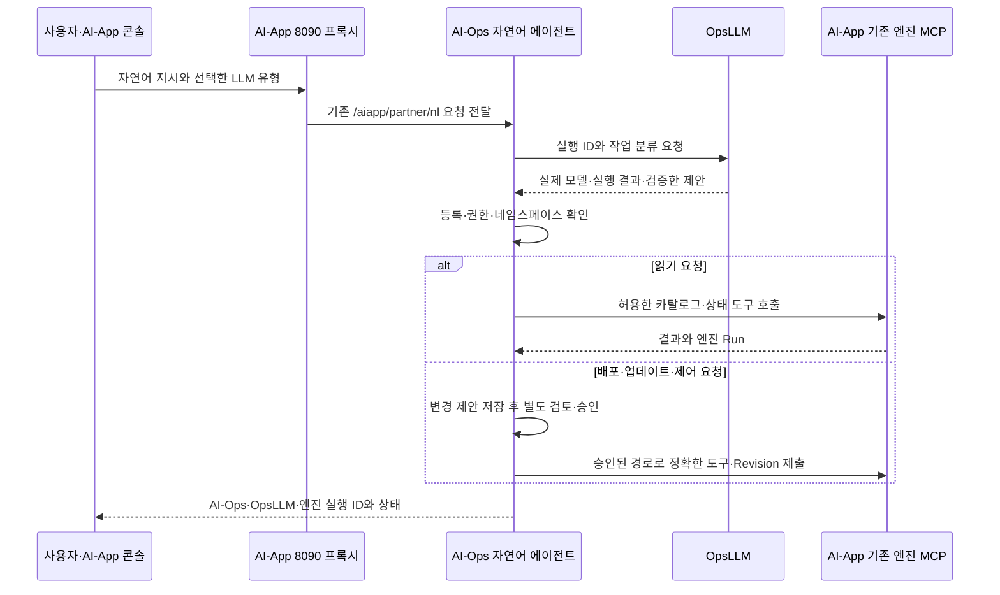

# AI-Ops 추가 구현과 AI-App 연동

2026-11-11 작업 트리 기준이다. AI-Ops는 AI-MCMP의 OpsLLM 실행과 자연어 운영 에이전트를 관리한다. 운영자가 지정한 LLM으로 지시를 해석하고, 등록한 프레임워크의 MCP 도구를 권한과 승인 범위 안에서 호출한다. 현재 연동의 중심은 `llmop`과 `app_automation_agent`다.

이 문서의 AI-Ops 구현은 `a9bc0d2`와 이후 통합 시험 스크립트·문서 변경을 기준으로 한다. AI-App에 추가한 요구 분석·인프라 추천·배포 및 업데이트 연결·추론 최적화는 [AI-App 구현 기록](../../ai-app/docs/api/khu-implementation.md)에 정리했다.

## 저장소와 실행 주체

| 구성 | 관리하는 기능 | 실제 실행을 맡기는 곳 |
| --- | --- | --- |
| AI-Ops `llmop` | OpsLLM 유형·후보 선택, 자연어 작업 분류, 호출 결과·실행 ID·모델·지연 기록 | 설정한 LLM 제공처 |
| AI-Ops `app_automation_agent` | 자연어 에이전트, Registry, 프레임워크 권한, 변경 검토·승인, 실행 결과 추적 | 등록한 AI-App·외부 프레임워크 MCP |
| AI-App 기존 구현 — 이노그리드 | 카탈로그, 응용 등록·버전, 배포·복구·제어 엔진, 배포 실행·로그·콘솔 | Semaphore와 CB-Tumblebug |
| AI-App 추가 구현 — 경희대 | 응용 요구 분석과 인프라 추천, 승인 Revision 실행 연결, 배포·운영 지표 연결과 학습 기반 추론 최적화 | 기존 AI-App 실행 기능과 Prometheus |
| CB-Tumblebug | CSP 스펙·이미지와 VM의 생성·조회·제어·종료 | CSP API |

AI-Ops는 도구 선택과 호출 권한, 검토한 변경의 승인을 관리한다. AI-App은 준비된 GPU 노드에 런타임·모델·응용을 배포한다. 운영 화면은 기존 AI-App 콘솔을 사용한다.

AI-App 엔진 카드의 이름은 `ai-mcmp-app-automation-engine`, 소유자는 `innogrid`다. 카드의 `framework: AI-Ops`, `servesFramework: AI-App`은 등록 분류이며, 엔진 코드는 AI-App 저장소의 `internal/engine`에 있다. 경희대의 `app_automation_agent`는 이 엔진을 호출하는 별도의 자연어 운영 에이전트다.

## 추가 구현

| 기능 | 코드 | 역할과 AI-App 연동 |
| --- | --- | --- |
| OpsLLM 라우팅·지시 해석 | [intent.go](../llmop/go/service-control-api/internal/profileapi/intent.go), [llmselection/](../llmop/go/service-control-api/internal/llmselection/) | 구독형·공개 모델·구축형 후보 중 설정한 모델을 호출하고 허용된 작업 제안으로 검증한다 |
| OpsLLM 실행 영속화 | [intent_runs.go](../llmop/go/service-control-api/internal/profileapi/intent_runs.go) | 호출 전에 실행 ID를 예약하고 결과·요청 해시를 저장한다. 같은 요청 재전송과 응답 유실 시 결과 조회를 지원한다 |
| 자연어 응용 운영 에이전트 | [aiapp_intent.go](../app_automation_agent/go/service-control-api/internal/api/aiapp_intent.go), [aiapp_intent_mcp.go](../app_automation_agent/go/service-control-api/internal/api/aiapp_intent_mcp.go) | 8090의 자연어 프록시와 REST·MCP로 연결한다. 조회는 등록한 엔진에 전달하고 쓰기는 변경 제안으로 기록한다 |
| AI-App 엔진 카드 등록 | [aiapp_engine_registry.go](../app_automation_agent/go/service-control-api/internal/api/aiapp_engine_registry.go) | 엔진의 워크플로·MCP·도구 정보를 역할·허용 작업·호출 경로로 매핑하고 재시작 후 복구한다 |
| 프레임워크별 권한 | [aiapp_intent_change.go](../app_automation_agent/go/service-control-api/internal/api/aiapp_intent_change.go), [framework-mcp-registry.md](../app_automation_agent/docs/framework-mcp-registry.md) | 호출 주체·에이전트·프레임워크·네임스페이스·작업을 정책과 대조한다. 등록과 실제 작업 권한을 구분한다 |
| 배포·업데이트 승인 연결 | [aiapp_prepare.go](../app_automation_agent/go/service-control-api/internal/api/aiapp_prepare.go), [aiapp_apply.go](../app_automation_agent/go/service-control-api/internal/api/aiapp_apply.go), [aiapp_intent_dispatch.go](../app_automation_agent/go/service-control-api/internal/api/aiapp_intent_dispatch.go) | 기존 계획을 AI-App 요청으로 변환하고 검토한 해시와 Revision을 승인 MCP에 전달한다. Run·배포 ID와 적용 상태를 저장한다 |
| 최적화 제안의 승인·비교 연결 | [aiapp_optimization.go](../app_automation_agent/go/service-control-api/internal/api/aiapp_optimization.go), [aiapp_optimization_compare.go](../app_automation_agent/go/service-control-api/internal/api/aiapp_optimization_compare.go) | AI-App이 만든 제안을 읽고 권한·근거를 확인한 뒤 승인한다. 학습과 지표 집계는 AI-App 구현을 사용한다 |
| 다른 프레임워크 MCP 등록 | [framework_mcp_registry.go](../app_automation_agent/go/service-control-api/internal/api/framework_mcp_registry.go), [framework_mcp.go](../app_automation_agent/go/service-control-api/internal/api/framework_mcp.go) | 서버 식별자·도구 스키마와 조회 계약을 확인해 등록하고, 정책에 허용한 조회를 호출한다 |
| 통합 시험 | [verify-aiapp-integration.sh](../platform/scripts/verify-aiapp-integration.sh) | 실제 배포를 대상으로 자연어 조회, OpsLLM·엔진 실행 연결, MCP 도구와 REST·MCP 기록 일치를 확인한다 |

## 기존 AI-App과의 호출 흐름

AI-App의 `AIAPP_MOCK_NL_URL`에는 운영 중인 `app_automation_agent` 주소를 넣는다. 이 변수는 기존 프록시의 설정 이름이다. AI-Ops는 운영자가 고정한 `AIOPS_AIAPP_BASE_URL`과 네임스페이스로 MCP를 호출한다. [실행 설정](getting-started.md#ai-app-8090-자연어-연동)

## LLM이 처리하는 범위

| 유형 값 | 의미 | 선택 방식 |
| --- | --- | --- |
| `subscription` | 구독형 LLM | 해당 유형의 첫 활성 후보 |
| `open_weights` | 무료 공개 모델 유형 | 해당 유형의 첫 활성 후보 |
| `self_hosted` | 구축형 LLM | 해당 유형의 첫 활성 후보 |

유형을 생략하면 `AIOPS_LLMOP_CANDIDATE_ID`의 활성 후보를 호출한다. 제공처 주소·모델·인증 참조는 서버의 후보 설정에서 정한다. 현재 자연어 호출 경로는 이 선택 규칙을 사용하며, `/api/v1/ops-llm/select`의 품질·비용 순위 계산은 별도 API다. 특정 모델 하나로 고정된 구현이 아니다.

LLM은 응용 목록·배포 상태·배포·업데이트·복구·VM 제어·제거·최적화 등의 작업 레이블을 분류한다. 배포 UUID는 원래 지시에서 Go가 추출하고, 모델에 보낼 때는 표시자로 치환한다. 임의 도구명·URL·셸 명령을 모델 출력에서 실행하지 않는다. 복수 작업이나 불분명한 요청은 `clarify`로 처리한다. [OpsLLM API·후보 설정](../llmop/go/service-control-api/README.md)

응용 요구의 CPU·GPU 조건을 스펙·이미지에 대조하는 기능은 AI-App의 추가 추천기가 담당한다. 기존 `ApplicationProfile` 생성 API는 연구·호환 기능으로 남아 있으며 현재 자연어 작업 분류와 구분한다.

## Registry·MCP·권한

AI-App 엔진은 시작할 때 `AIAPP_ENGINE_REGISTRY_URL`의 `/agents`로 카드를 보낸다. AI-Ops의 수신 경로는 `POST /api/v1/integrations/ai-app/agents`다.

| 엔진 카드 정보 | Registry에서 사용하는 정보 |
| --- | --- |
| `owner`, `framework`, `servesFramework` | 소유자와 소속·대상 프레임워크 |
| `workflows`, `tools.exposed[].name/grade/guardedByDryRun` | 허용된 작업과 조회·쓰기 구분 |
| `mcpEndpoint`, 운영자 지정 AI-App 주소 | 실제 MCP 호출 경로 |
| 등록 당시 네임스페이스·엔진 식별자 | 범위 검사와 변경 검토 해시 |

기본 조회 작업은 카드와 정책이 함께 허용하는 `list_applications`, `application_status`다. 쓰기 작업에는 별도 호출 주체의 권한과 검토·승인이 필요하다. `AIOPS_FRAMEWORK_ACCESS_POLICY_FILE`에 호출 주체별 에이전트·프레임워크·네임스페이스·작업을 지정한다. 정책 활성화 이력도 저장한다.

자연어 에이전트는 `/aiapp/partner/nl/mcp`에 Streamable HTTP MCP를 제공한다. `run_application_intent`, `get_application_intent_run`으로 지시와 기록을 처리하고, 권한 있는 호출자는 `prepare_application_intent_change`, `approve_application_intent_change`, `get_application_intent_change`로 변경을 검토한다. REST와 MCP는 같은 실행 기록을 사용한다. [변경 승인 계약](../app_automation_agent/docs/aiapp-intent-approval.md)

AI-Infra·AI-HA·AI-Conn 등은 `/api/v1/framework-agents/{agent}`에 운영자가 설정한 MCP 서버와 조회 도구를 등록한다. 등록 때와 호출 전에 서버 이름·버전·스키마를 대조한다. 현재 범용 프레임워크 등록 경로는 조회용이며, AI-App 쓰기는 기존 승인 경로를 사용한다. 각 프레임워크의 서버 자체 개발과 운영 주소·도구 계약은 담당 기관의 범위다. [프레임워크 MCP 등록](../app_automation_agent/docs/framework-mcp-registry.md)

## 실행 기록과 재시작

아래 경로는 각 서비스의 `AIOPS_REPO_ROOT` 아래에 있다. 재시작할 때 같은 경로·접속 설정·인증값을 사용한다.

| 기록 | 저장 위치 | 보존하는 내용 |
| --- | --- | --- |
| OpsLLM 실행 | `runs/ops-llm/` | 요청 해시, 실제 모델, 지연, 상태와 검증한 제안 |
| AI-App 엔진 등록 | `runs/aiapp-engine-registry.json` | 카드, 운영자 지정 주소·네임스페이스, 허용 작업 |
| 자연어 실행 | `runs/aiapp-intents/` | 지시, 단계별 도구·결과, OpsLLM·엔진 Run 연결 |
| 자연어 변경 | `runs/aiapp-intent-changes/` | 검토한 계획·해시·승인과 실행 결과 |
| 승인 적용 | `runs/aiapp-apply/` | Flow·Revision별 정확한 요청과 적용 영수증 |
| 프레임워크 등록·정책 | `runs/framework-mcp/`, `runs/framework-access/history/` | MCP 계약 저장본과 정책 활성화 이력 |

AI-App의 배포 저장소와 엔진 아카이브도 별도로 유지한다. OpsLLM의 완료 미확인 상태, AI-Ops의 승인 기록, AI-App의 실제 적용 상태는 각각의 기록으로 대조한다. 같은 OpsLLM 실행 ID에 같은 요청을 보내면 저장 결과를 반환하고 다른 요청이면 `409`로 거절한다.

게이트웨이, OpsLLM, 엔진 등록, 엔진 승인, 운영자·호출 주체의 토큰은 용도별로 구분한다. 문서와 공개 설정에는 값 대신 환경변수 이름을 사용한다.

## 기존 연구 코드와의 관계

| 경로 | 현재 용도 |
| --- | --- |
| `llmop`의 `ApplicationProfile` 생성·벤치마크 | 기존 응용 요구 분석 API와 분석용 모델 비교 재현 |
| `resource_ops` | 관측 자원 정규화·조건 검사·후보 점수화 연구와 기존 API 호환 |
| `app_automation_agent`의 Guard·계획·Revision | 기존 판단 검증과 AI-App 요청 준비에 활용 |
| `platform` | 연구 Flow, 구형 AppDeploy 실험 어댑터, 통합 Swagger |
| `poc/research_policy`, `poc/optimization_research` | 과거 실측 자료의 학습·재생·성능 예측 연구 |

현재 자연어 연동은 `llmop`과 `app_automation_agent`로 실행한다. 응용 설치·삭제·VM 생성기를 AI-Ops에 새로 중복 구현하지 않는다. 현재 AI-App용 인프라 추천과 vLLM 최적화의 구현 위치는 AI-App 저장소다. 연구 PoC의 별도 실행 경로와 과거 검증 결과는 당시 버전·설정의 범위로 해석한다.

## 검증 범위와 남은 시험

2026-11-11에 AWS T4의 Ollama·`qwen3-vl:8b`를 구축형 OpsLLM으로 사용해 다음을 확인했다.

- AI-App 8090 자연어 API의 카탈로그·실제 배포 상태 조회와 OpsLLM·엔진 Run 연결
- 자연어 MCP 초기화·도구 호출과 REST·MCP 실행 기록의 일치
- 잘못된 토큰 `401`, 범위 밖 네임스페이스 `403`, 다른 본문의 실행 ID 재사용 `409`
- 업데이트 지시의 제안 저장과 승인 전 미실행
- LLM Op·에이전트 재시작 후 Registry·OpsLLM·자연어 실행 기록 복구
- 통합 시험 스크립트의 재시작 전후 통과와 두 모듈의 `make test vet` 통과

같은 날 별도 T4 VM에서 승인 MCP를 통한 vLLM·Qwen3-1.7B FP16·응용 배포와 추론 설정 변경 Revision 적용을 확인했다. AI-Ops는 승인과 MCP 전달을, AI-App은 설치·업데이트와 관측·학습을 수행했다. 초기 엔진 응답 대기 시간 초과 후 같은 요청의 재전송은 배포 ID를 보존했다.

두 부하·두 설정·다섯 반복의 실제 측정 20개 구간을 배포·엔진 Run·Revision·측정 창과 연결했다. 학습·검증·최종 시험은 반복 회차별 3·1·1로 분리했다. 최종 관측이 학습 범위를 벗어나 Random Forest는 holdout 기준을 통과하지 못했고 변경 판단을 보류했다. 저부하에서는 소수점 경계 판정도 개선 사항으로 확인했다. [실측 조건과 결과](../../ai-app/README.ko.md#2026-11-11-승인-배포추론-최적화-실측)

새 기준 관측으로 게시한 `ABSTAIN` 제안을 실제 호출 주체의 권한으로 조회했다. 등록된 AI-App 승인 MCP를 통해 `eligible: false`가 반환됐고, 승인은 `AIAPP_OPTIMIZATION_CONFLICT`와 HTTP `409`로 거절됐다. 다음 Revision도 생성되지 않았다. 검증 실패 모델의 적용 차단을 확인했으며 강제로 적용하지 않았다.

검증을 통과한 모델 제안의 실제 승인·적용·사후 비교, 승인 후 복구·제어와 자연어 지시부터 실적용까지의 전체 흐름, 구독형·공개 모델 제공처 실호출과 AI-Infra·AI-HA·AI-Conn 기관 서버 연동은 후속 시험 범위다. 단위 시험과 모의 서버 결과를 해당 환경의 운영 검증으로 확대하지 않는다. 이번 실험 드라이버·원시 측정 자료·모델 산출물·도표는 로컬 Git 제외 경로에 보관한다.

시험용 GPU VM과 루트 디스크는 종료·삭제했고, 관리 호스트의 기록은 보존했다. 원시 실험 자료·개인 설정·토큰은 Git에서 제외한다. [GPU 설치·통합 시험 절차](../../ai-app/docs/api/gpu-installation.md)와 [통합 확인 스크립트](../platform/scripts/verify-aiapp-integration.sh)로 재현한다.
