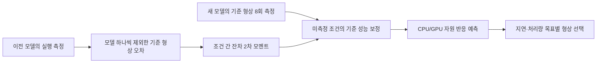

# 응용 조건 잔차 전이를 이용한 CPU/GPU 형상 추천: 연구 방법 v1

## 제안 범위

경희대의 **첫 방법 후보**는 새 AI 모델을 모든 형상에서 실행하지 않고도, 앱의 구조화된 요청 조건별 배치 지연과 요청 처리량을 예측해 정적 CPU/GPU 형상을 고르는 것이다. 핵심 구성은 **이전 모델의 모델 제외 예측 오차 패턴을 새 모델의 소수 기준 측정에 조건화하고, 보정된 기준 성능을 별도 자원 반응 모델에 전달하는 두 단계 추론**이다. 이전 논문과 원리를 공유하므로 최초의 경험적 공분산 방법이라고 주장하지 않는다. 경희대의 기여로 제시할 수 있는 것은 AI 응용 컨텍스트, 교차검증 잔차, CPU/GPU 응답, 적은 실제 측정 비용, 두 성능 제약을 한 평가 프로토콜로 결합한 **구체적인 방법과 적용 범위**다.

이 버전이 처리할 수 있는 입력은 모델 종류·등록된 파라미터 크기·작업 종류, 배치 크기, 최대 입력 길이, 동시성, 목표 배치 p95 지연 및 요청/초다. 후보는 같은 호스트의 GPU 복제 1/2개와 CPU affinity 제한 2/4/8/16코어이다. `GPU 2개`는 같은 작업을 두 복제 프로세스가 각각 실행한 합산 벤치마크 용량이며, VM 두 대로 실제 확장한 결과가 아니다. [측정 의미](replica_benchmark_semantics.md) RAM/VRAM 필요량, VM 제품·가격·리전, 실제 온라인 요청 SLO와 Scale-out/in action은 이 방법의 학습 정답에 없다.

## 학습과 추론

요청 조건을 `c`, 후보 자원 형상을 `r`, 기준 형상을 `r₀=(GPU 1, CPU 2)`라 하고 성능은 `log(배치 p95 지연)`과 `log(요청/초)` 두 값으로 둔다.

1. 이전 모델 자료로 절대 성능 예측기 `f₀(c,r)`와, **기준 형상의 성능을 입력받아** 다른 CPU/GPU 형상의 상대 반응을 예측하는 모델 `g(c,r,y(c,r₀))`을 학습한다.
2. 이전 모델 `m`마다 `m`을 제외하고 `f₀⁽⁻ᵐ⁾`을 다시 학습한다. 같은 입력 조건의 기준 형상에서 `zₘ(c)=yₘ(c,r₀)−f₀⁽⁻ᵐ⁾(c,r₀)`을 만든다. 이 내부 모델 제외 단계가 없으면 학습 모델의 과소평가된 잔차가 새 모델의 전이 prior에 들어간다.
3. 같은 조건 격자가 정렬된 이전 모델들의 잔차로 `Kₑ(c,c′)=meanₘ[zₘ(c)zₘ(c′)]`를 만들고, 부드러운 좌표 커널 `Kₛ`와 **각 50%** 섞어 `K=0.5Kₑ+0.5Kₛ`로 둔다. 지연과 요청/초에는 각각 별도의 `K`를 쓴다. 구현의 `Kₑ`는 평균을 제거한 공분산이 아닌 **비중심 2차 모멘트**다. 관측 잡음은 각 지표의 평균 대각값의 5%로 고정한다.
4. 새 모델의 입력 조건 64개 중 정적 좌표 medoid 8개에서만 기준 형상을 실행한다. 관측 잔차 `z_P`로 `ẑ_C=K_{C,P}(K_{P,P}+σ²I)^{-1}z_P`를 계산하며, 이미 측정한 위치는 실측값으로 대체한다.
5. `f₀(c,r₀)+ẑ(c)`를 새 모델의 기준 성능으로 삼고 `g`로 8개 형상의 지연·요청/초를 예측한다. 목표를 만족할 것으로 예측한 후보 중 **GPU 개수, 이어서 CPU affinity 제한**이 작은 것을 반환한다. 만족 후보가 없으면 선택을 보류한다. 이 순서는 실제 VM 가격의 대체가 아니다.

입력 조건과 같은 작업 종류의 donor가 두 개 미만이거나 정렬된 64조건 격자가 없으면 이 v1의 **검증된 개선 범위 밖**이다. 코드의 부드러운 커널 대체 경로는 비교·탐색용으로 남기되, 그 결과에 이 방법의 개선 수치를 붙이지 않는다. 운영 연동에서는 이 경우 별도 `UNSUPPORTED` 또는 보류 응답을 내도록 인터페이스를 구분해야 한다. 현재의 지연은 실제 사용자 요청 p95가 아니라 배치 벤치마크 p95다.

향후 이노그리드 연동용 연구 모듈 출력에는 후보별 `gpu_process_replicas_same_host`, `cpu_affinity_limit`, `predicted_batch_p95_ms`, `predicted_request_rps`, `anchor_measurements=8`, `support_status`와 선택 근거를 담는다. 이 값은 **실험 형상 추천**이며 VM ID, CSP·리전·상품명, 메모리·이미지 요구량 또는 실제 Scale-out 명령을 뜻하지 않는다. 현재 구현은 후보별 예측과 평가 결과를 Parquet/CSV로 저장한다. 이 인터페이스는 아직 구현하지 않았다.

## 같은 측정 비용에서 얻은 이점

고정 SQLite에서 encoder 8모델을 하나씩 완전히 제외했다. 모델당 같은 GPU1/CPU2 조건 8개, 평균 **5.757 GPU-wall초**를 모든 방법에 허용했다. 오차는 모델별 평균 절대 로그오차의 평균이며, 생성 SLO 성공은 실측상 가능한 입력 조건 309개 중 실제 목표를 만족하는 형상을 고른 수다.

| 방법 | 지연 오차 ↓ | 요청/초 오차 ↓ | 생성 SLO 성공 ↑ | 위반 ↓ |
| --- | ---: | ---: | ---: | ---: |
| 제안한 이전 모델 잔차 전이 | **0.2351** | **0.1192** | **298/309** | **13** |
| 같은 앵커·부드러운 커널만 | 0.2470 | 0.1351 | 290/309 | 17 |
| 같은 앵커·직접 Ridge 보정 | 0.2508 | 0.1420 | 292/309 | 15 |

커널 대비 지연 오차는 **4.8%**, 요청/초 오차는 **11.8%** 낮았다. 개선된 모델은 각각 6/8개와 7/8개다. 가장 크게 개선된 BERT L4-H256을 제외해도 남은 7개에서 평균 오차 감소가 지연 **0.00670**, 요청/초 **0.00816**이었다. 기존 잔차를 조건 간 무작위로 바꾼 64개 대조군은 원래 정렬보다 오차가 커져, **조건에 맞춘 이전 모델의 오차 패턴이 정보가 된다**는 내부 근거를 제공한다. [학습·분할·모델별 결과](cross_model_covariance_findings.md), [순열 대조](covariance_permutation_control_findings.md)

8회를 택한 이유도 측정 비용과 함께 남겼다. 같은 encoder군에서 4회는 평균 지연/처리량 오차 `0.260/0.128`, GPU-wall `3.00`초였고, 16회는 `0.233/0.103`, `12.68`초였다. 8회는 `0.235/0.119`, `5.76`초로 중간 비용의 기준점이다. 8회가 모든 비용 함수에서 최적이라는 뜻은 아니다. [예산별 결과](cross_model_covariance_findings.md)

원래 수집 SLO가 지나치게 쉬운 경우를 확인하려고, 평가 모델을 제외한 훈련 모델의 지연·요청 처리량 분위수로 25개 목표 조합도 만들었다. 실제 8개 형상 중 일부(1–7개)만 가능한 **3,794개 상관된 작업·목표 질의**에서는 잔차 전이/커널의 성공 선택이 **3,191/3,135**, 잘못 승인이 **286/308**이었다. 같은 작업을 25번 묻는 설계이므로 3,794개를 독립 표본으로 보지 않는다. 실제 사용자가 낸 SLO의 효과도 아니다. [목표 난도와 오류 구성](slo_case_mix_findings.md)

이 숫자는 유효한 **한 호스트·공유 조건 격자·유사 encoder군의 탐색 결과**다. BERT+DistilBERT 계열을 함께 학습에서 제외하면 지연 오차는 제안 방법 `0.3868`, 커널 `0.3695`로 역전된다. 새 입력 조건에서도 처리량 오차가 커널보다 novel-matrix `0.379/0.361`, space-filling `0.352/0.324`로 나빴다. [계열 제외](family_holdout_transfer_findings.md), [새 조건](cross_model_covariance_findings.md) 같은 수집기 버전의 반복 측정 조건에서는 두 방법의 차이가 사실상 없었다. [반복 측정](live_repeat_transfer_findings.md) 생성 SLO도 실제 사용자가 낸 요구가 아니므로 운영 효과를 의미하지 않는다.

## 기존 연구와 이 방법의 차이

[Empirical Gaussian Processes](https://arxiv.org/html/2602.12082)는 역사적 함수의 경험적 공분산으로 새 함수의 부분 관측을 보정한다. [Paragon](https://people.csail.mit.edu/delimitrou/papers/2013.asplos.paragon.pdf)과 [Quasar](https://people.csail.mit.edu/delimitrou/papers/2014.asplos.quasar.pdf)는 이전 응용과 소수 프로파일을 이용해 QoS 자원을 선택한다. [PowerTrain](https://arxiv.org/html/2407.13944)은 소수 프로파일로 새 DNN의 엣지 학습 시간·전력을 전이하고, [MaverIQ](https://ut-sysml.ece.utexas.edu/publications/prints/sc2025_liakopoulos.pdf)는 작은 모델 fingerprint와 분석식을 사용해 LLM 배포 형상을 추정한다. 따라서 경험적 공분산, sparse profiling, QoS 선택 **각각은 선행 원리**다. 이 v1의 구체적인 차이는 **원 성능 곡선이 아닌 모델 제외 기반 예측 오차**를 prior로 만들고, 새 모델의 8개 실제 측정을 조건화한 뒤, 별도의 CPU/GPU 반응 예측과 두 목표의 형상 선택으로 연결하는 구성이다. 이 정도의 **응용 및 방법 조합상의 신규성**을 주장하되, 학술적 최초성이나 다른 모델 계열로의 일반화는 주장하지 않는다.

## 다음 판정 기준

현재 구현은 [학습·추론 코드](../scripts/cross_model_covariance.py), [고정 데이터와 예측·모델별 지표](../artifacts/cross_model_covariance_v1/metrics.json), [검증 테스트](../tests/test_cross_model_covariance.py)로 재현한다. 연구용 형상 추천 모듈에는 입력 조건·자원 후보별 예측과 선택 근거를 제공하고, 실제 배포 명세 변환은 이노그리드 Adapter가 담당하도록 경계를 둔다.

현재는 기존 SQLite만 쓸 수 있으므로 **독립적인 새로운 모델·호스트 검증은 수행할 수 없다.** 향후 그 자료가 생기면 같은 8회·동일 GPU-wall 예산, 모델·계열 제외, 미관측 조건, 실제 요청 SLO와 VM 비용을 사전 고정해 비교한다. 두 예측 지표 중 하나가 악화되거나 잘못된 배포 승인이 늘면 적용 범위를 줄이거나 방법을 기각한다. 이 기준은 현 결과를 논문 수준으로 포장하기 위한 사후 임계값이 아니다.
