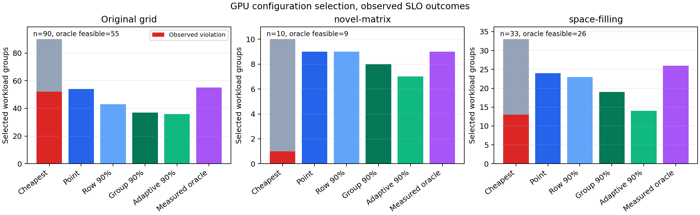

# GPU 인프라 형상 선택 연구: 예측 오차 보정의 실효성

## 연구 질문과 결론

**연구 질문:** AI 응용의 지연시간·처리량 예측 오차를 후보 집합 단위로 보정하면, SLO 위반을 줄이면서 적은 GPU로 응용을 실행할 수 있는가?

**결론:** 이 벤치마크에서는 보정 전 성능 예측 정책이 이미 좋은 후보를 골랐다. 원본 평가 조건 90개 중 54개를 선택해 모두 관측 SLO를 만족했다. 90% 동시 보정 정책은 37개만 선택했고 관측 위반은 똑같이 0건이었다. 따라서 **이번 데이터로는 보정을 추가할 실익을 확인하지 못했다.** 이는 보정법의 일반적 무효를 뜻하지 않는다.

## 관련 연구와 이 실험의 차이

- [CherryPick, NSDI 2017](https://www.usenix.org/conference/nsdi17/technical-sessions/presentation/alipourfard)은 여러 클라우드 구성 중 성능이 좋은 구성을 적은 시험 횟수로 찾는 문제를 Bayesian optimization으로 다룬다. 여기서는 모든 8개 후보가 측정된 그룹에서 **선택 정책 자체**를 비교한다.
- [Conformalized Quantile Regression, NeurIPS 2019](https://papers.neurips.cc/paper_files/paper/2019/file/5103c3584b063c431bd1268e9b5e76fb-Paper.pdf)은 학습과 별도 보정 집합으로 예측구간을 조정한다. 이 실험은 이를 동기로 삼되, CQR을 그대로 구현한 것이 아니다. 한 그룹의 **모든 후보와 두 성능 지표**를 동시에 보호하도록 최대 잔차 점수를 사용한다.
- [Conformal Risk Control, ICLR 2024](https://proceedings.iclr.cc/paper_files/paper/2024/file/f3549ef9b5ff520a7e41ff3cc306ab2b-Paper-Conference.pdf)은 단조 손실을 전제로 한다. 보정폭을 넓히면 선택 후보가 바뀌어 실현 위반 손실이 단조가 아닐 수 있으므로, 이 논문의 위험 보장을 이 정책에 적용하지 않았다.

## 데이터와 단위

- 원본: `/path/to/aiops/runs/khu-hf-local-exhaustive/executions.sqlite3`에서 고정 추출한 측정 스냅샷 (`../data/audit_v1/measurements.parquet`). 같은 호스트의 물리 GPU 1개 또는 2개와 CPU affinity 2/4/8/16개, 총 8개 자원 후보를 **575개 입력 조건마다 전부 측정**했다.
- GPU 2개는 같은 호스트의 서로 다른 장치다. 다중 VM scale-out의 실행 효과를 측정한 자료가 아니다.
- `latency_p95_ms`는 배치 호출의 p95 지연, 두 GPU면 가장 느린 replica의 p95다. `examples_per_second`는 처리 샘플/초, 두 GPU면 개별 처리량의 합이다.
- 목표 `target_throughput_rps`의 단위는 요청/초다. **측정 요청 처리량 = `examples_per_second / batch_size`**로 변환했다. 이 변환을 생략하면 원본 test에서 모든 후보가 합격하는 입력 조건은 32개 대신 65개가 된다.
- SLO 목표는 수집 스크립트에서 생성한 값이다. 실제 사용자가 선언한 SLO가 아니며, end-to-end 서비스 latency도 아니다.
- 가격이 없으므로 자원 비용은 **GPU 수 우선, 동률이면 CPU affinity core 수**의 사전 정의된 사전식 순서로 비교한다. 금전적 절감으로 해석하지 않는다.

## 방법

1. 모델·입력 길이·batch·동시성 등이 같은 8개 자원 후보를 하나의 workload 그룹으로 묶는다. 기존 575그룹 분할을 유지하되 기존 train 396그룹에서 99그룹을 별도 보정용으로 분리한다. 최종 구성: 모델 학습 297그룹, 보정 99, 기존 검증 89, test 90. 모델과 보정은 서로 다른 그룹을 사용한다.
2. 기존 실험에서 검증셋으로 선정한 200-tree Extra Trees를 297그룹에서 다시 학습한다. 입력에는 응용·부하·자원 설정만 넣고, 지연·사용률·SLO 성과는 넣지 않는다. 두 양의 성능 지표의 로그를 예측한다.
3. 보정 그룹의 후보별 단측 잔차를 구한다: `max(log(실측 지연/예측 지연), log(예측 요청처리량/실측 요청처리량))`. 그룹 점수는 8개 후보 잔차의 최댓값이다. 이 그룹 점수 99개의 `ceil((99+1)×0.9)`번째 값을 보정폭 `q`로 사용한다.
4. 후보가 `예측 지연×exp(q) ≤ 지연 SLO`와 `예측 요청처리량/exp(q) ≥ 처리량 SLO`를 모두 만족하면 허용한다. 허용 후보 중 사전 정의 자원 순서상 가장 작은 구성을 선택하고, 없으면 보류한다.
5. 기준선은 항상 최소 자원 선택, 보정 없는 점 예측 선택, 후보별 행 잔차로 보정한 방식, 그룹 동시 보정 80%/90%, 실측 결과로 고른 oracle이다. 행 단위 보정은 후보 선택 후의 동시 보장을 갖지 않으므로 비교용이다.
6. 추가 탐색으로 나무별 로그 예측 표준편차에 0.10을 더한 후보별 scale을 사용하고, 그룹 최대 정규화 잔차로 90% 동시 보정했다. **이 방법은 첫 test 결과를 본 뒤 추가**했으므로 확인적 개선 주장에 사용할 수 없다.

## 결과

원본 test 90개 그룹 중 실측상 어떤 후보로도 SLO를 만족하지 못하는 그룹이 **35개**다. 따라서 선택 가능한 상한은 55개다.

| 정책 | 선택 / 90 | 선택 후보의 관측 위반 | 실측 가능 55개 중 성공 선택 | 성공 선택의 oracle 대비 평균 추가 GPU 수 |
| --- | ---: | ---: | ---: | ---: |
| 최소 자원 고정 | 90 | 52 | 38 | 0.00 |
| **점 예측 선택** | **54** | **0** | **54** | **0.11** |
| 행 단위 90% 보정 | 43 | 0 | 43 | 0.28 |
| 그룹 동시 80% 보정 | 41 | 0 | 41 | 0.37 |
| 그룹 동시 90% 보정 | 37 | 0 | 37 | 0.32 |
| 후보별 scale 동시 90% | 36 | 0 | 36 | 0.47 |
| 실측 oracle | 55 | 0 | 55 | 0.00 |

점 예측의 성공 선택률은 `54/55=98.2%`, 그룹 동시 90% 보정은 `37/55=67.3%`다. 두 정책 모두 관측 위반 0건이지만 54건에서 0건의 이항 95% 정확 구간 상한도 약 6.6%다. 이 크기의 데이터로 두 정책의 참 위반 위험이 같다고 단정할 수 없다.

| 별도 캠페인, 학습 범위 내 그룹 | 점 예측 선택/위반 | 그룹 동시 90% 선택/위반 | oracle 가능 그룹 |
| --- | ---: | ---: | ---: |
| `local-novel-matrix`, 10/18그룹 | 9 / 0 | 8 / 0 | 9 |
| `local-space-filling`, 33/44그룹 | 24 / 0 | 19 / 0 | 26 |

보정 그룹의 90% 그룹 최대 잔차 임계값은 로그 척도 `q=0.7114`다. 이는 지연 상한과 처리량 하한을 각각 약 2.04배 보수적으로 만드는 크기다. test에서는 90그룹 모두, 별도 캠페인에서 평가 가능한 10·33그룹 모두 후보 전체 동시 경계 안에 들어왔다. 반면 후보별 나무 분산 방식은 원본 test 87/90그룹에 동시 경계를 제공했으나 선택 수가 36개로 더 적었다.

## 해석과 한계

점 예측 정책의 성과는 한 호스트의 정적 후보 실험과 생성된 SLO에서 확인됐다. CPU core가 2인 후보가 실측 oracle에서 항상 가장 낮은 자원 순서로 선택돼, 실제 선택 난도는 주로 GPU 1개와 2개 사이에 있다. 8개 후보라 해도 독립된 복잡한 클라우드 형상 8개를 비교했다고 볼 수 없다.

보정 정책이 선택 수를 줄였으나 관측 위반을 줄이지 못한 것은 현재 SLO가 후보들을 뚜렷하게 구분하고 점 예측이 이미 보수적으로 작동한 결과로 **해석한다**. 측정당 한 번의 실행, 2026년 9월의 짧은 수집 기간, 한 호스트, 생성된 SLO 때문에 실제 서비스 품질 보장으로 확장할 수 없다.

교환가능한 신규 workload 그룹에서 모든 후보의 결과가 같은 방식으로 생성된다는 가정 아래 그룹별 최대 잔차는 후보 선택 후의 동시 경계 근거가 된다. **이 고정 격자·시간 연속 수집 데이터가 그 가정을 입증하지는 않는다.** 명목 90%는 개별 모델/부하마다 90% 또는 선택된 작업 중 위반율 10% 이하를 보장하지 않는다.

모델 종류인 Extra Trees는 이전 성능 예측 실험에서 원래 학습 그룹 전체와 검증 그룹으로 선정됐다. 따라서 이번에 별도로 떼어낸 99개 보정 그룹의 결과가 **과거 모델 종류 선택에 간접적으로 관여했다.** 이번 실험은 보정 결과의 경험적 평가이며, 독립 보정 표본을 전제로 한 엄밀한 유한표본 보장을 주장하지 않는다. 그 보장을 검증하려면 처음부터 건드리지 않은 신규 보정·시험 캠페인이 필요하다.

이번 결과는 초기 90개 test 그룹의 결과를 확인한 뒤 후보별 scale 실험을 추가했다. 후보별 방식은 탐색 결과로만 해석한다. 외부 캠페인의 일부 입력은 학습 범위 밖이어서 평가에서 제외했으며, 외부 캠페인의 관측 동시 경계가 100%라는 사실도 미래 분포 이동의 보장을 뜻하지 않는다.

## 다음 실험에 필요한 데이터

1. 같은 형상·부하의 반복 실행으로 지연·처리량 변동과 선택한 후보의 재현성을 측정한다.
2. 실제 사용자 요청 단위 SLO, 열린 유입률과 대기열, VM 가격 또는 명시적인 GPU/CPU 자원 비용을 수집한다.
3. 새 모델·호스트와 장치에서 별도 확인용 평가셋을 만든다. 미지원 조합과 분포 이동에서 보류가 얼마나 발생하는지도 포함한다.
4. 실제 scale-out/in의 준비 시간·실패·전환 중 SLO를 기록해 정적 후보 선택과 운영 제어를 연결한다.

실험 코드와 원시 정책별 선택은 [실행 코드](../scripts/evaluate_gpu_policy.py), [지표 JSON](../artifacts/gpu_policy_v1/metrics.json), test 선택 기록 (`../artifacts/gpu_policy_v1/choices_test.csv`)에 있다.
